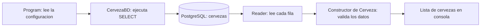

# FundamentosCSHARP

Proyecto de consola para aprender C#, colecciones, programacion orientada a objetos
y consultas a PostgreSQL. Usa .NET 10 y Npgsql 10.0.3.

## Ejecutar los ejercicios

Los comandos siguientes se ejecutan desde la carpeta que contiene `FundamentosCSHARP.slnx`.
Si estas dentro de la carpeta del proyecto, usa primero `cd ..`.

```powershell
dotnet restore FundamentosCSHARP.slnx
dotnet build FundamentosCSHARP.slnx
dotnet run --project .\FundamentosCSHARP
```

En Visual Studio puedes abrir la solucion y ejecutar con Ctrl+F5.
Para aprender con el depurador, coloca un punto de interrupcion en `EjemploPoo()`.

## Lo que ya has construido

| Tema | Donde verlo | Que significa |
|---|---|---|
| Tipos de datos | Comentarios de `Program.cs` | Numeros, texto, booleanos y fechas. |
| Colecciones | Arrays, listas y recorridos en `Main` | Almacenar y recorrer varios valores. |
| Objetos y constructores | `new Cerveza(300)` | Crear un objeto con estado inicial. |
| Encapsulamiento | `Bebida.Cantidad` y `Beberse` | Cambiar el estado mediante operaciones validadas. |
| Herencia | `Cerveza : Bebida` y `Vino : Bebida` | Reutilizar el comportamiento comun. |
| Abstraccion | `Bebida` | Representar las caracteristicas esenciales; no es una clase `abstract`. |
| Polimorfismo | `Describir`, `virtual` y `override` | Una variable `Bebida` ejecuta la version del objeto real. |
| Interfaces | `IBebidaAlcoholica` | Definir un contrato compartido por clases distintas. |
| Agregacion | `Nevera` | Contener bebidas que tambien existen fuera de ella. |
| Acceso a datos | `CervezaBD.GetAsync` | Convertir filas de PostgreSQL en objetos `Cerveza`. |

## Preparar PostgreSQL

Necesitas PostgreSQL en ejecucion y una base llamada `FundamentosCSharp`.
En la revision se comprobo que esa base ya existia localmente. Se creo la tabla
`cervezas` y se insertaron dos registros de ejemplo con el script siguiente.

Para preparar otra instalacion, ejecuta en PowerShell:

```powershell
psql -h localhost -p 5432 -U postgres -d FundamentosCSharp -W -v ON_ERROR_STOP=1 -f .\database\ejemplo-postgresql.sql
```

Tambien puedes abrir el script en la herramienta de consultas de pgAdmin y
ejecutarlo conectado a esa base. El script no crea la base de datos.
No elimina registros y evita volver a insertar los mismos ejemplos en una ejecucion secuencial.
Si ya tienes una tabla con otro esquema, `CREATE TABLE IF NOT EXISTS` no modifica sus columnas.

La tabla tiene `id` (identificador generado), `nombre` y `marca` (texto),
`alcohol` (porcentaje entero entre 0 y 100) y `cantidad` (mililitros enteros no negativos).
Todos son obligatorios. Para mantener el ejemplo sencillo, no admite porcentajes decimales.

## Conectar y consultar desde C#

Configura la variable de entorno en la misma ventana de PowerShell desde la que
ejecutaras el programa. Este ejemplo pide la contrasena sin escribirla en el historial:

```powershell
$clave = Read-Host 'Contrasena de PostgreSQL' -AsSecureString
$configuracion = New-Object System.Data.Common.DbConnectionStringBuilder
$configuracion['Host'] = 'localhost'
$configuracion['Port'] = '5432'
$configuracion['Database'] = 'FundamentosCSharp'
$configuracion['Username'] = 'postgres'
$configuracion['Password'] = (New-Object System.Net.NetworkCredential('', $clave)).Password
$env:FUNDAMENTOS_DB = $configuracion.ConnectionString
Remove-Variable clave, configuracion

# Consultar todas las cervezas:
dotnet run --project .\FundamentosCSHARP -- --bd

# Consultar por una marca exacta:
dotnet run --project .\FundamentosCSHARP -- --bd 'Marca de practica'

# Quitar la configuracion al terminar:
Remove-Item Env:FUNDAMENTOS_DB
```

La variable dura en esa sesion; no se guarda en el repositorio.
Si ejecutas desde Visual Studio, el proceso debe recibir tambien esa variable.
Sin `--bd`, los ejercicios habituales funcionan sin necesitar PostgreSQL.

El recorrido de la consulta es:



`await` espera las operaciones de base de datos sin bloquear el hilo durante la espera.
`await using` libera el lector, el comando y la fuente de conexiones al terminar,
incluso si ocurre una excepcion. El filtro utiliza `$1`: la marca se envia como
parametro y no se concatena dentro del SQL.
Referencia: [uso basico oficial de Npgsql](https://www.npgsql.org/doc/basic-usage.html).

## Correcciones y comprobaciones de la revision

El intento inicial combinaba una conexion PostgreSQL con `System.Data.SqlClient`,
un proveedor de SQL Server. Ademas, `new(Cerveza(...))` no era una construccion valida,
`Alcohol` era de solo lectura y `Marca` no existia.

Ahora se utiliza Npgsql; la clase y el archivo se llaman `CervezaBD`;
el constructor de `Cerveza` recibe y valida marca y alcohol sin setters publicos.
Los constructores anteriores siguen funcionando con sus valores opcionales.

Se verificaron compilacion sin errores ni advertencias, ejecucion de los ejercicios
de POO, conexion real a PostgreSQL, lectura de los dos ejemplos, filtro por marca,
lista vacia para una entrada con texto de inyeccion SQL y deteccion de configuracion ausente.
Esto cubre el ejemplo de consulta; no implementa alta, edicion ni eliminacion desde C#.

Si falta `FUNDAMENTOS_DB`, el programa termina con codigo 1 y explica que configurarla.
Si PostgreSQL rechaza el SQL, muestra su codigo SQLSTATE. Por ejemplo, `42P01`
indica una tabla inexistente. Los errores de conexion muestran un mensaje sin credenciales.
